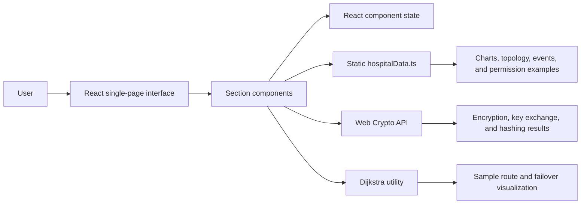
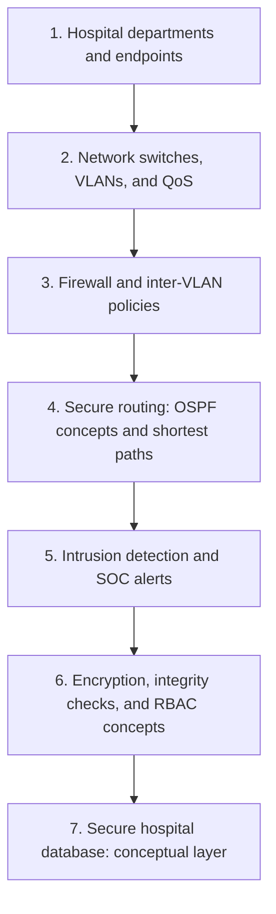
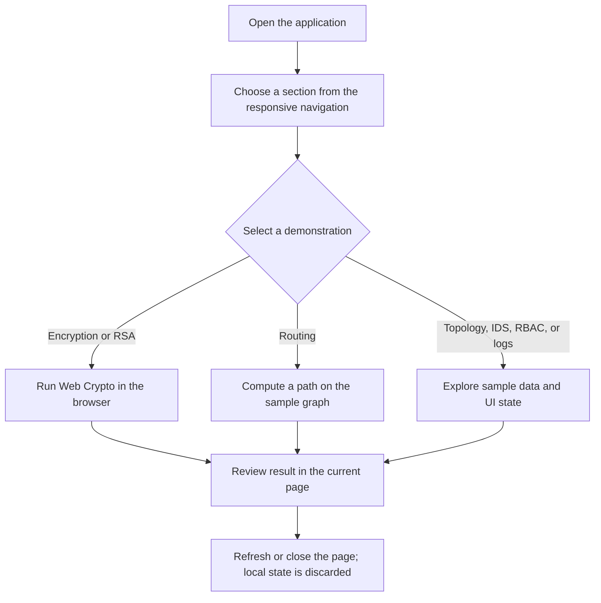

# MEDGUARD AI

### Intelligent Secure Hospital Network — Interactive Security Operations Center Demonstration

**Protecting patient data. Securing hospital networks. Enabling smarter healthcare.**

[](https://react.dev/)
[](https://www.typescriptlang.org/)
[](https://vite.dev/)
[](#project-overview)

> **Project status:** Interactive academic demonstration. It is not a hospital information system, a production security product, or an AI-powered monitoring service.

## Table of contents

- [Project overview](#project-overview)
- [Problem, vision, and objectives](#problem-vision-and-objectives)
- [Features, users, use cases, and value](#features-users-use-cases-and-value)
- [Screenshots and branding](#screenshots-and-branding)
- [Architecture and workflows](#architecture-and-workflows)
- [Technology stack](#technology-stack)
- [Project structure](#project-structure)
- [Application design](#application-design)
- [Setup and configuration](#setup-and-configuration)
- [Build, production, and deployment](#build-production-and-deployment)
- [Testing, debugging, and operations](#testing-debugging-and-operations)
- [Security and performance](#security-and-performance)
- [Contributing and project process](#contributing-and-project-process)
- [Limitations and roadmap](#limitations-and-roadmap)
- [FAQ and troubleshooting](#faq-and-troubleshooting)
- [Changelog, license, credits, and contact](#changelog-license-credits-and-contact)
- [Project summary](#project-summary)

## Project overview

MEDGUARD AI is a single-page React application that teaches core security concepts through a simulated hospital network operations center. Users can inspect a fictional hospital topology, explore example security events, run browser-based cryptography demonstrations, calculate routes through a sample network graph, and review example role permissions.

The interface combines two kinds of behavior:

- **Working local demonstrations:** AES-256-GCM encryption/decryption, RSA-OAEP key wrapping, SHA-256 hashing, and Dijkstra shortest-path calculation.
- **Illustrative simulations:** Dashboard metrics, topology status, intrusion detection results, access-control decisions, and security logs are sample data or UI demonstrations. They do not connect to hospital devices or enforce security policies.

The project is a CNIP final-year academic demonstration. The “AI” name is branding; there is no machine-learning model, AI agent, backend service, or live monitoring pipeline in this repository.

## Problem, vision, and objectives

### Problem statement

Healthcare environments handle sensitive patient records across many departments and connected devices. This project illustrates how confidentiality, integrity, network segmentation, threat monitoring, routing resilience, and least-privilege access can be considered together in a hospital security design.

### Vision

Make layered hospital-network security easier to understand by presenting its concepts and selected algorithms in an interactive, visual learning environment.

### Objectives

1. Demonstrate authenticated encryption and integrity checks using fictional records.
2. Explain public-key wrapping of a symmetric session key.
3. Visualize a segmented hospital network and a conceptual defense-in-depth model.
4. Demonstrate shortest-path routing and link-outage recalculation.
5. Present sample intrusion alerts and security audit events.
6. Explain role-based permissions for common hospital staff profiles.

## Features, users, use cases, and value

### Features

| Area | What the application demonstrates | Implementation status |
|---|---|---|
| Security dashboard | KPI cards, sample alerts, traffic and activity charts, department status | Static demonstration data |
| Hospital topology | Clickable SVG nodes with sample network and security details | Interactive, static data |
| Algorithm guide | AES, RSA, SHA-256, Dijkstra, OSPF, IDS, and RBAC concepts | Explanatory content |
| Encryption laboratory | AES-256-GCM encryption/decryption, key rotation, SHA-256 digest and tamper comparison | Real browser Web Crypto operations |
| RSA demonstration | RSA-OAEP 2048-bit key-pair generation and AES session-key wrap/unwrap | Real browser Web Crypto operations |
| Intrusion detection | Severity filters and a scan animation over predefined events | Simulated; no packet inspection |
| Secure routing | Select endpoints, calculate a weighted shortest path, disable links, inspect rerouting | Working Dijkstra algorithm on sample graph |
| RBAC matrix | Switch among Doctor, Nurse, Administrator, and Laboratory Technician permissions | Static policy illustration; not authorization |
| Security logs | Search, filter, and append sample log entries in the current page session | Local in-memory simulation |
| Architecture and project overview | Seven conceptual defense layers, problem statement, and objectives | Educational reference model |

### Target users

- Students learning security, networking, cryptography, or healthcare technology.
- Educators demonstrating security algorithms and defense-in-depth.
- Developers evaluating the project as a front-end learning example.
- Product and architecture stakeholders reviewing the proposed conceptual model.

### Use cases

- Compare how symmetric encryption, public-key cryptography, and hashing differ.
- Change sample text and observe authenticated decryption or hash comparison behavior.
- Inspect hospital departments, sample links, VLAN details, and security status.
- Find a route between nodes, then disable a link and recompute the route.
- Review fictional access decisions and filter simulated security events.

### Business and educational value

The application brings several security concepts into one navigable demonstration, making it useful for presentations, coursework, and introductory design discussions. It can help explain ideas and trade-offs, but it does not provide operational protection, compliance evidence, or clinical workflow functionality.

## Screenshots and branding

The application includes an inline SVG MEDGUARD shield logo in `src/components/MedGuardLogo.tsx`. There are no screenshot image assets in the repository yet. Add genuine captures under a project-owned image directory and update this section when screenshots are available; no screenshots are implied by this documentation.

## Architecture and workflows

### Runtime architecture

The implemented application runs entirely in the browser. React renders the interface, static TypeScript data supplies the fictional hospital content, and selected demonstrations use the browser Web Crypto API or local algorithms.



There is no application server, network API, database, external hospital integration, or authentication service in the current implementation.

### Conceptual hospital defense-in-depth model

The architecture section in the application describes an educational hospital-network model. These layers are conceptual and are not provisioned or operated by this front-end project.



### Application workflow

1. Vite serves `index.html` and the TypeScript entry point during development.
2. `src/main.tsx` mounts the React application.
3. `src/App.tsx` composes the page sections and handles navigation between them.
4. Components render local data from `src/data/hospitalData.ts`.
5. User actions update component state, invoke a local algorithm, or call Web Crypto.
6. Results are rendered in the page; no result is sent to or persisted by a server.

### End-to-end user flow



## Technology stack

| Technology | Use |
|---|---|
| React 18 | Component-based single-page UI |
| TypeScript 5 | Typed UI, domain data, and utilities; strict compiler options |
| Vite 5 | Development server and production bundler |
| Tailwind CSS 4 with the Vite plugin | Styling and responsive layout |
| Recharts 2 | Dashboard charts |
| Lucide React | Interface icons |
| Browser Web Crypto API | AES-GCM, RSA-OAEP, random bytes, and SHA-256 demonstrations |
| SVG | Inline logo, network diagrams, and visualizations |

The application imports Google Fonts (Inter, JetBrains Mono, and Space Grotesk) from Google Fonts in `index.html`; those font requests need network access. Other listed libraries are installed through npm.

## Project structure

```text
secure-hospital/
├── index.html
├── package.json
├── package-lock.json
├── tsconfig.json
├── vite.config.ts
└── src/
    ├── App.tsx
    ├── main.tsx
    ├── index.css
    ├── components/
    ├── data/
    ├── types/
    └── utils/
```

Generated folders such as `node_modules/` and `dist/` are not source and should not be committed.

### Major folders

| Path | Responsibility |
|---|---|
| `src/components/` | Page sections and reusable presentation elements for dashboard, topology, demos, navigation, and architecture |
| `src/data/` | Typed, fictional dashboard metrics, network graph, events, role profiles, logs, algorithms, and architecture layers |
| `src/types/` | Shared TypeScript domain contracts for topology, routing, events, permissions, logs, and architecture |
| `src/utils/` | Browser cryptography helpers and the reusable Dijkstra shortest-path implementation |

### Important files

| File | Purpose |
|---|---|
| `index.html` | Browser document shell, page title, font preconnects, and React mount point |
| `package.json` | Project metadata, dependency declarations, and `dev`, `build`, and `preview` scripts |
| `package-lock.json` | Reproducible npm dependency resolution |
| `vite.config.ts` | Vite React and Tailwind CSS plugin configuration |
| `tsconfig.json` | Strict TypeScript and browser compilation settings |
| `src/main.tsx` | React root creation, strict mode, and global stylesheet import |
| `src/App.tsx` | Page composition, navigation, active-section tracking, and demo event signals |
| `src/index.css` | Tailwind import, theme defaults, SOC visual styles, animations, and scrollbar styling |
| `src/data/hospitalData.ts` | Source of static sample metrics, topology, routing graph, RBAC profiles, IDS events, logs, algorithms, and layers |
| `src/types/security.ts` | Shared domain types and unions |
| `src/utils/crypto.ts` | Hex/base64 conversion and Web Crypto AES-GCM, RSA-OAEP, and SHA-256 operations |
| `src/utils/dijkstra.ts` | Weighted graph shortest-path calculation and disabled-edge support |

#### UI components

| Component | Responsibility |
|---|---|
| `HeroSection.tsx` | Introductory branding, animated network illustration, and section navigation |
| `SidebarNav.tsx` | Responsive desktop sidebar and mobile menu |
| `DashboardSection.tsx` | Sample KPIs, charts, department status, and alerts |
| `TopologySection.tsx` | Interactive SVG hospital topology and selected-node details |
| `AlgorithmsSection.tsx` | Algorithm descriptions and RSA demonstration dialog |
| `EncryptionLabSection.tsx` | Fictional text input, AES-GCM encrypt/decrypt, key rotation, SHA-256, and tamper comparison |
| `IntrusionDetectionSection.tsx` | Simulated scan animation, predefined event results, and severity filtering |
| `SecureRoutingSection.tsx` | Source/destination selection, route visualization, and disabled-link simulation |
| `RbacSection.tsx` | Sample role selection and permission matrix |
| `SecurityLogsSection.tsx` | In-memory log search, filters, and sample event generation |
| `ArchitectureSection.tsx` | Seven-layer conceptual defense model |
| `AboutSection.tsx` | Project motivation, proposed approach, and academic objectives |
| `SectionHeader.tsx` | Shared section heading and simulation-status label |
| `MedGuardLogo.tsx` | Inline SVG shield and medical cross logo |

## Application design

### Frontend architecture

`src/App.tsx` arranges the page as a collection of section components and coordinates smooth navigation. Each section owns its local interaction state with React hooks. The dashboard and topology use SVG or Recharts visualizations; shared domain data remains separate in `src/data/`.

### Backend architecture

There is no backend in this project. The browser has no configured API client, server routes, or remote business logic.

### Database architecture

There is no database. Sample records, logs, metrics, and policies are TypeScript constants. User-generated UI changes and new sample logs live only in React state for the lifetime of the page.

### API overview

No HTTP or GraphQL API is implemented or consumed. The application’s callable operations are local functions:

- Web Crypto operations from `src/utils/crypto.ts`.
- Shortest-path calculation from `src/utils/dijkstra.ts`.
- Component callbacks that coordinate navigation and demonstrations.

### Authentication and authorization

There is no login, identity provider, session management, or enforced authorization. The RBAC section is a display-only sample matrix; it does not protect data or restrict application operations.

### State management

State is managed with React `useState`, `useEffect`, and `useMemo` inside the page and section components. There is no Redux, Context-based global store, or persistence layer.

### Storage strategy

The application does not persist data to local storage, IndexedDB, cookies, or a server. Web Crypto keys and UI state are held in browser memory. A page refresh discards generated keys, results, and added sample logs.

### Third-party services and integrations

| Integration | Purpose | Data behavior |
|---|---|---|
| Google Fonts | Loads typography referenced by the UI | Browser makes font requests to Google when online |
| Web Crypto API | Performs local cryptographic demonstrations | Operations run in the current browser; the app does not upload input |
| npm packages | UI, chart, icon, styling, and build dependencies | Installed at development/build time |

No AI/automation service, cloud storage, analytics, telemetry, SIEM, or hospital system is integrated.

## Setup and configuration

### Prerequisites

- Node.js 18 or newer (Node.js 20 LTS is recommended).
- npm, normally included with Node.js.
- A modern browser with Web Crypto API support.
- Internet access to download npm packages; online access is also needed for the hosted fonts.

### Installation

```bash
git clone https://github.com/laharireddy1010/secure-hospital.git
cd secure-hospital
npm ci
```

For a fresh repository checkout without a lockfile, use `npm install` instead of `npm ci`.

### Environment variables

No environment variables are required or read by the application. There is no `.env` file to configure. Do not add real patient information, credentials, or secrets to the sample data.

### Project configuration

- `vite.config.ts` enables the React and Tailwind CSS Vite plugins.
- `tsconfig.json` enables strict type checking, no emitted TypeScript output, and modern browser libraries.
- `package.json` defines the package scripts and dependency ranges.
- `index.html` sets the document title and external font links.

## Build, production, and deployment

### Development server

```bash
npm run dev
```

Open the local URL printed by Vite (typically `http://localhost:5173`). Vite’s localhost origin is suitable for the browser cryptography demonstrations.

### Production build

```bash
npm run build
```

This runs the TypeScript project build (`tsc -b`) followed by `vite build`. The static site output is written to `dist/`.

### Previewing the production build

```bash
npm run preview
```

This serves the generated `dist/` output locally for a production-build check. It is not a production hosting service.

### Deployment guide

The application is a static Vite site. To deploy it, run the production build and publish the contents of `dist/` to a static host such as GitHub Pages, Netlify, Vercel, or an internal web server. Configure the host’s SPA fallback to serve `index.html` for the application path. No provider-specific deployment configuration is included in this repository.

Use HTTPS in deployed environments. The Web Crypto API generally requires a secure context; browsers normally treat `localhost` as secure for development. No server-side secrets or environment variables are needed.

### Build process

1. TypeScript checks the project according to `tsconfig.json`.
2. Vite bundles the React application and CSS.
3. The resulting static assets are emitted to `dist/`.

### CI/CD

No CI workflow, automated deployment, or release pipeline is configured in the project. A future pipeline should install from `package-lock.json`, run `npm run build`, and deploy `dist/` only after successful validation.

## Testing, debugging, and operations

### Testing strategy

There is no automated unit, integration, or end-to-end test suite configured, and no `test` script in `package.json`. The available baseline verification is:

```bash
npm run build
```

Manually check the page at desktop and mobile widths; exercise encryption/decryption, tamper detection, RSA key exchange, route calculation and failover, topology selection, IDS severity filters, RBAC selection, and log filtering.

### Debugging tips

- Use the browser developer console for runtime exceptions and React warnings.
- Confirm the browser context supports `window.crypto.subtle`; use localhost or HTTPS.
- If crypto operations fail, inspect the displayed error and check browser support/security context.
- For a route that cannot be found, confirm the selected graph links have not been disabled.
- For layout issues, check the browser viewport and network requests for the externally hosted fonts.

### Logging and monitoring

There is no server logging, production telemetry, or monitoring integration. The Security Logs section is a simulated interface backed by in-memory sample entries, not an actual audit trail. Browser developer tools are the only runtime diagnostics available by default.

## Security and performance

### Security considerations

- **Educational use only:** do not connect this demonstration to clinical systems or use it to make security or patient-care decisions.
- **Never enter real PHI:** the encryption lab is for fictional sample text. Browser-side encryption does not make an application compliant or provide secure key management.
- The AES key is intentionally displayed in the UI for teaching and is retained in browser memory; this is not a production key-handling pattern.
- RSA-OAEP keys are generated for a demonstration and are not persisted, authenticated, or used to secure a real connection.
- The IDS, firewall, OSPF, and RBAC interfaces do not observe or control real traffic, routes, or permissions.
- Sample IP addresses, metrics, threats, and network details are illustrative, not operational data.
- Review third-party dependency updates and Google Fonts privacy/network requirements before any public deployment.

### Performance

The application is a small client-rendered SPA with local datasets and no server round trips. It uses responsive chart containers and memoization for selected filtering/derived data. No performance benchmark, load test, or production performance target is currently defined.

## Contributing and project process

Contributions to the educational demonstration are welcome. Before opening a pull request:

1. Create a focused branch from the repository’s default branch.
2. Keep changes scoped and preserve the explicit simulated-versus-real behavior labels.
3. Run `npm ci` and `npm run build`.
4. Describe the user-visible change and include screenshots for visual changes when possible.
5. Never include secrets, real patient data, credentials, or generated `node_modules/` and `dist/` output.

No `CONTRIBUTING.md`, code formatter, lint script, or issue template is currently configured. Prefer the existing TypeScript and component conventions; discuss larger feature or architecture changes in an issue before implementation.

### Coding standards and conventions

- React function components with TypeScript and explicit domain types.
- Shared demonstration data in `src/data/hospitalData.ts`.
- Reusable algorithms and browser crypto helpers in `src/utils/`.
- Strict TypeScript configuration; avoid weakening checks to silence errors.
- Keep sample content fictional and label simulated behavior clearly.

### Versioning, branching, and releases

The package currently declares version `1.0.0`. No formal versioning, branching, tagging, or release automation policy is configured. Semantic Versioning and short-lived feature branches are reasonable conventions for future releases; they are recommendations, not existing project automation. Releases should include a summary of behavior changes and validation performed.

## Limitations and roadmap

### Known limitations

- Frontend-only; no backend, real API, database, login, or persistent storage.
- Most telemetry and security results are static or simulated.
- IDS is not a packet analyzer or production detection engine.
- OSPF is explained conceptually; the route demonstration recalculates a sample graph using Dijkstra and disabled edges.
- The permission matrix is not a security boundary.
- No automated tests, CI/CD, deployment configuration, or monitoring is present.
- External Google Fonts require network access.

### Future roadmap

The following are possible future directions, not committed or implemented work:

- Add component and utility tests, followed by browser-level end-to-end tests.
- Add accessibility checks and document keyboard/screen-reader behavior.
- Add a CI workflow for build and test verification.
- If the project’s scope changes beyond an educational demo, design and review a backend, secure identity, audited authorization, data retention, and key management before handling any sensitive data.
- Add screenshots and deployment instructions for a selected host.

## FAQ and troubleshooting

### Does this application use AI?

No. “AI” is part of the project branding; this codebase contains no AI model, agent, or inference API.

### Are dashboard alerts and IDS findings live?

No. They are illustrative values and predefined events rendered in the browser.

### Is there an API or database?

No. The project is entirely client-side and uses TypeScript constants for its sample content.

### Can I enter actual patient data in the encryption lab?

No. Use only fictional text. The demo displays key material and is not designed or validated for handling PHI.

### `npm ci` fails

Confirm Node.js and npm are installed and that the network can reach the npm registry. If the lockfile is absent or intentionally changed, use `npm install` to regenerate it.

### Cryptography is unavailable

Use a modern browser and open the application on `localhost` or over HTTPS. Some browsers disable Web Crypto in insecure origins or restricted contexts.

### The fonts do not load

The app loads fonts from Google Fonts. Check network access; the browser’s local fallback fonts will still be used when the remote font request is unavailable.

### The page is blank or build fails

Check the browser console and terminal output. Reinstall dependencies with `npm ci`, then run `npm run build` to surface TypeScript or bundling errors.

## Changelog, license, credits, and contact

### Changelog

No changelog or release history is included yet. Add dated entries here as project releases are made.

| Version | Notes |
|---|---|
| `1.0.0` | Version declared in `package.json`; this README documents the repository’s current academic demonstration. |

### License

No license file or license declaration is present in the repository. Until a license is added, do not assume that the code is available for reuse, modification, or redistribution. Add a `LICENSE` file before describing the project as open source.

### Credits and acknowledgements

Built as a CNIP final-year academic demonstration. The interface uses React, TypeScript, Vite, Tailwind CSS, Recharts, Lucide React, and the browser Web Crypto API. The project’s own UI contains the MEDGUARD shield logo.

### Contact

For project questions or contributions, use the [GitHub repository](https://github.com/laharireddy1010/secure-hospital). No separate maintainer email or support channel is specified in this project.

## Project summary

MEDGUARD AI is an interactive, browser-only educational SOC demonstration for a fictional hospital network. It combines working local cryptography and shortest-path examples with clearly simulated dashboards, network monitoring, logs, and access-control views. It is intended to help people learn and discuss security architecture—not to secure real healthcare systems or process real patient data.
